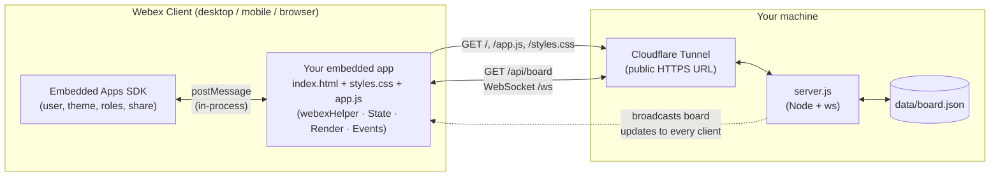

# Webex Retro Board Project

[](CODE_OF_CONDUCT.md)
[](LICENSE)
[](https://opensource.cisco.com)

Welcome! In this project you'll build and improve a **Webex Embedded App** — a
*team retro board* that runs right inside Webex. As a software engineer, you
rarely only deal with code you've written yourself. A lot of the job is
actually getting to grips with code someone else wrote. Being able to quickly
get up to speed on an unfamiliar project and start contributing is an
invaluable skill to have, and this project is designed to give you an idea of
what that's like. You'll practise making sense of an existing codebase and
building on top of it, **fixing existing bugs** and tackling **feature
requests**.

This app is designed to help teams run a retro without leaving Webex — it
gives them a shared board inside the meeting or space. A "retro"
(retrospective) is a regular meeting in Agile/Scrum teams where a team
reflects on how things are going. There are many formats; this app uses a
common one with three columns: **Start / Went well**, **Stop**, and
**Continue**. Teams fill those columns with cards, vote on them, and discuss
the points on the board.

> **What's an Embedded App?** An embedded app is a web application
> (HTML/CSS/JavaScript) that Webex loads directly inside the client, in a
> meeting or a space. To help your app talk to Webex, Webex provides the
> **Embedded Apps SDK** ([docs](https://developer.webex.com/docs/embedded-apps)),
> which you'll use to find out who's using the app, react to meeting events
> (such as who's the host), and share your app with everyone in the meeting
> or space.

## The project at a glance

You'll work through four tasks, finishing with a final task where you'll
create an embedded app of your own!

1. **Task 1 — Set up & run "Hello Retro"** — get the starter app running inside Webex.
2. **Task 2 — Explore the code** — read and understand what's already there.
3. **Task 3 — Fix bugs & add features** — build on the existing app.
4. **Task 4 — Make it your own** — the main event: build a new embedded app, and present your work.

## What you'll need

- **git** — https://git-scm.com/download/
- **Node.js (LTS)** — https://nodejs.org/ (runs the app and its local backend)
- **A code editor** — [VS Code](https://code.visualstudio.com/) is recommended
- **A GitHub account** — free; https://github.com/join (used to fork and store your
  project code)
- **Cloudflare Tunnel (`cloudflared`)** — free; install it using
  [Cloudflare's instructions](https://developers.cloudflare.com/cloudflare-one/connections/connect-networks/downloads/)
  to give your locally running app a temporary public HTTPS address
- **A Webex Developer Sandbox** — free; see Task 1 (a normal free Webex account
  **cannot** create embedded apps)

---

# Task 1 — Set up and run "Hello Retro"

The goal of Task 1 is to get the starter app running *inside Webex* and see it greet
you by name. You'll develop the app **locally** for fast feedback, then use a
**Cloudflare Quick Tunnel** to give Webex a temporary public HTTPS address for your
locally running app.

## 1. Get the code
Fork this repository on GitHub (top-right **Fork** button) so you have your own copy,
then clone it:
```sh
git clone https://github.com/<your-username>/webex-retro-board-project.git
cd webex-retro-board-project
ls
```
The app files are at the top level of the project: `index.html`, `styles.css`,
`app.js`.

## 2. Install and run the app locally
Each student runs the Node server from their own project folder. It serves the
front end and backend together. In Terminal, run:
```sh
npm install
npm start
```
Run `npm install` once after cloning the project. Each time you work on it, run
`npm start`. Open `http://localhost:3000` in your browser. The status should say
**Shared board connected**. The server saves the board in `data/board.json` on your
computer, so it is still there after restarting the server.
Outside Webex, the console may show a warning that the Webex SDK isn't available —
that's expected; everything except Webex-only features still works.

> **Keep this running while you develop.** Almost all of your work — fixing bugs and
> adding features — is tested here, locally, with instant reloads.

### Use one shared board with your team

Each student's local server has its own board. To work together on one board, one
person starts their Node server and Quick Tunnel and shares the tunnel URL with the
team. Everyone else opens that same URL in their browser or Webex app. The host's
computer must stay on, with both the Node server and tunnel running. The other
students can still run their own local servers for development; those servers have
separate boards.

The app connects to the Node server at `/api/board` and `/ws`. The server sends the
current board to connected browsers. When someone adds, deletes, or votes on a card,
the server saves the change to `data/board.json` and sends the updated board to
everyone connected to that server. The Webex **Share with everyone** button shares
the app URL; the Node backend keeps the board data in sync.

The trial backend has no login and one board per server. Anyone with the tunnel URL
can view and change that board, so use demo data only and stop the tunnel when the
session is over.

## 3. Get a Webex Developer Sandbox (per team)
Embedded apps need a *licensed* Webex organisation. Cisco gives these to developers
for free as a **Developer Sandbox**.

1. As a team, pick one person to open
   https://developer.webex.com/docs/developer-sandbox-guide and click
   **Request a Sandbox**.
2. Check email for the credentials (organisation name, admin username, password).
   - **Use an email that is _not_ already registered with Webex** when requesting.
     Using an existing-Webex email can trigger a password-reset on that account
     instead of creating a sandbox. A `+alias` like `you+retro@gmail.com` works well.
3. That person signs in to [Webex Control Hub](https://admin.webex.com) in an
   **incognito window** and adds their teammates as users. Each sandbox allows up to
   **10 people**.
4. Everyone signs in to the Webex app using their **sandbox** account for this
   project.

## 4. Give your local app a public HTTPS address
Webex needs a **public HTTPS** address for your app; it can't load `localhost` on
your computer directly. A Cloudflare Quick Tunnel temporarily makes your local app
available at a public `trycloudflare.com` address. You do not need a Cloudflare
account or a domain.

1. Leave the Node server running from step 2.
2. Open a **second Terminal window** and run:
   ```sh
   cloudflared tunnel --url http://localhost:3000
   ```
3. Wait for `cloudflared` to print a URL like
   `https://some-words.trycloudflare.com`. Open it in a browser and confirm the
   board loads. Keep this Terminal window open too.

> The tunnel URL is temporary. It stops working when you stop `cloudflared`, and a
> new tunnel may have a different URL. Keep both the Node server and tunnel running
> while you use the app in Webex. Quick Tunnels are intended for testing and
> development, not as a permanent website.

### Alternative for a static demo: GitHub Pages

If you only need to demonstrate the app without a Node backend, you can host
the static files with GitHub Pages instead of running a Quick Tunnel. Push your
project to GitHub, then open its **Settings → Pages** and deploy the `main` branch
from the `/ (root)` folder. GitHub will provide a stable HTTPS URL for the app.
When you follow step 5, use that URL with `/index.html` as the Webex **Start Page URL** and
its host (for example, `<your-username>.github.io`) as the **Valid domain**, instead
of the Quick Tunnel URL.

This is convenient for a static demo, but updates appear only after you push your
changes and Pages finishes deploying. GitHub Pages serves only the front end, so
the board is saved separately in each browser. Use the Node server and Quick Tunnel
for the normal setup and shared boards.

## 5. Create the Embedded App in the Developer Portal
1. Go to https://developer.webex.com and sign in **with your sandbox account**.
2. Open **My Webex Apps → Create a New App → Create Embedded App**.
3. Fill in:
   - **Where does your app work?** — tick **Meeting** and **Messaging**.
   - **Embedded app name** — e.g. "Team Retro Board".
   - **Start Page URL** — your current tunnel URL + `/index.html`, e.g.
     `https://some-words.trycloudflare.com/index.html`.
   - **Valid domains** — the host from your current tunnel URL, e.g.
     `some-words.trycloudflare.com` (just the host — **not** `https://` or a path).
4. Click **Add Embedded App**.

> If you stop and restart the tunnel, its URL may change. Update the Start Page URL
> and Valid domains in your embedded app settings to match the new URL.

## 6. Open it in Webex
1. In the Webex desktop app (signed in with your sandbox account), start a meeting
   or open a space.
2. Click the **Apps** button/tab, scroll to in-development apps, and open
   **Team Retro Board**.
3. Choose **Open and share my personal information** so the app can greet you.

You should see the board — and the header should say **"Hi <your name>"**. 🎉

<details>
<summary><b>Nothing loads / errors?</b></summary>

- Open the current tunnel URL directly in a browser first — does the board load
  there? If not, check that the Node server and `cloudflared` are both running.
- Check the **Start Page URL** ends in `/index.html` and **Valid domains** matches
  the host in your current tunnel URL.
- If you restarted `cloudflared`, copy its new URL into the embedded app settings.
- Make sure you're signed in with the **sandbox** account, not a personal one.
- Right-click inside the app and choose **Inspect** to open developer tools and read
  the console.

</details>

<details>
<summary><b>It says "Hi there" instead of my name?</b></summary>

- Outside Webex (a plain browser tab) this is expected — the name only comes through
  when the app runs **inside** the Webex client.
- Inside Webex, make sure you chose **Open and share my personal information** when
  launching the app. Without it, Webex withholds your name and the app falls back to
  a friendly default.
- Reload the app (close and reopen it) — embedded apps cache aggressively.

</details>

---

# Task 2 — Explore the Retro Board app

The goal of this task is to become more familiar with how the code is structured
and to explore some of the features of the Retro Board app.

## How it all fits together

Before reading the code, here's the big picture of how the pieces talk to each
other:



- **The Webex client** loads your page inside a meeting or space and injects
  the **Embedded Apps SDK** directly into it — this is how `app.js` reads
  your name, theme, and meeting role.
- **Outside Webex**, you can open the same page in a plain browser tab for
  testing (see Task 1) — everything still works except the Webex-specific
  bits, since `window.webex` won't exist there.
- **Cloudflare Tunnel** gives your locally running Node server a public
  HTTPS address, since Webex can't load `localhost` directly (see Task 1).
- **`server.js`** serves the static files, keeps one shared `board` in
  memory and in `data/board.json`, and broadcasts every change to all
  connected clients over a WebSocket — this is what makes the board "shared"
  rather than just local to your own browser.

Open `app.js`. It's organised into **four clearly commented areas**:

1. **Webex SDK helper (`webexHelper`)** — everything that talks to Webex (who the
   user is, the theme, sharing).
2. **State** — the `board` object and the functions that change it: `addCard`,
   `deleteCard`, `voteCard`, and `saveState`/`loadState` (which use the Node backend
   by default, or `localStorage` as a fallback if the backend is unavailable).
3. **Render** — functions that turn the `board` into what you see: `renderBoard`,
   `renderColumn`, `createCardElement`, `updateCounts`.
4. **Events** — wiring buttons and the form to state changes, then re-rendering.

## Debugging tips

When something behaves unexpectedly, follow one user action through the code:
the **Events** area handles the click or form submit, a state function changes
`board`, and the **Render** area updates the page. For example, adding a card
flows from the form handler in `wireEvents()` to `addCard()`, then to
`renderBoard()`.

### Debug with VS Code

The project includes VS Code launch options in `.vscode/launch.json`. Open the
project folder in VS Code, select a configuration from **Run and Debug**, and
press **F5**:

- **Debug Node backend** starts `server.js` under the debugger. Set breakpoints
  in `server.js`, then use the app in a browser. Node requests and WebSocket
  messages will pause at those breakpoints, where you can inspect **Variables**
  and **Call Stack** and step through the code. Stop any server already running
  on port 3000 before launching this configuration.
- **Debug Retro Board in Chrome** opens `http://localhost:3000` in Chrome for
  front-end debugging. Start the server separately with `npm start`, set
  breakpoints in `app.js`, and use the browser's **Sources** panel or VS Code's
  browser debugger to step through the front end.

When execution pauses, inspect **Variables** and **Call Stack** to see the
current values and how the code got there. Step over a line to follow the flow
without entering every helper; step into a function when you want to inspect it.

### Use browser developer tools

Open developer tools with **F12** or **Ctrl+Shift+I** on Windows/Linux, or
**Cmd+Option+I** on Mac. In Webex, right-click inside the embedded app and
choose **Inspect** if that option is available; otherwise reproduce the issue
at `http://localhost:3000` in a browser, where the same front-end code runs.

- **Console:** look for red errors and warnings. Click a filename and line
  number in a message to jump to the source. The warning that the Webex SDK is
  unavailable in a normal browser is expected; Webex-only features need to be
  tried inside Webex.
- **Sources:** set breakpoints in `app.js`, then perform the action in the page.
  You can inspect local variables and step through the code just as in VS Code.
- **Network:** reload the page and check that `GET /api/board` succeeds. Select
  the **WS** filter and open the `/ws` connection to inspect messages when cards
  are added or votes change. A failed request or a closed WebSocket often means
  the local server is stopped or the page is pointed at a different server.
- **Elements:** inspect the board markup and styles when a card exists but is
  missing, misplaced, or styled unexpectedly.
- **Application/Storage:** inspect `localStorage` if the app is using its
  browser-storage fallback. With the normal Node server, the shared board is
  stored in `data/board.json` instead.

### Add temporary console logs

Use `console.log()` to print a small, useful value at each stage of the flow.
For example, temporarily add a log in the form handler, in `addCard()`, and
before `renderBoard()` runs:

```js
console.log("Form submitted", { text: textEl.value, column: columnEl.value });
console.log("Adding card", { text: clean, column });
console.log("Rendering board", board.cards.length, "cards");
```

Read the output in the browser Console. If the first message appears but the
next one does not, the issue is between those steps. For backend activity,
`server.js` logs appear in the terminal running `npm start`. Remove temporary
logs when you finish debugging so the console stays useful.

## Explore the features together

Now that everyone has their own copy running, pick one person's tunnel URL from
Task 1 and have everyone on the team open that same board — inside Webex
(**Open for all** / **Add to tab**) or by pasting the tunnel URL into a browser
tab.

### Features to try

Try these as a team and watch what happens on the other screens:

- **Add a card** to each of the three columns (**Start**, **Stop**, **Continue**).
- **Vote** on a teammate's card.
- **Delete** a card.

Once everyone can see each other's changes show up, your shared board is working
— your Node server keeps one shared board, and everyone who opens the same
tunnel URL is looking at the same board, live. You're ready to move on to the
next task.

---

# Task 3 — Make improvements to the Retro Board app

For this section, the aim will be to extend the functionality of the retro board
app. You will be adding new features of your own and addressing some issues with
the current implementation.

## Part A — Discover some issues

Before adding anything new, try out the board together and see if you can spot
any issues with how it currently behaves.

Discuss in your group what would happen if:
- You click vote on the same card several times.
- You start the 5-minute timer, then refresh the page.
- Two people each start their own timer on their own screens.
- You delete a card that someone else on the team added.

- **Exercise:** Try these out to determine what the current behaviour is and
  have a think about what the desired behaviour should be.

The most obvious one: right now, anyone can vote on the same card as many
times as they like, which defeats the point of voting in a retro. Can you
think of a good way to prevent this?

- **Exercise:** Change `voteCard` so each person can only vote once per card.

  <details>
  <summary><b>Hint</b></summary>

  You'll need some way of remembering *who* has already voted on a card, not
  just *how many* votes it has got. Look at how `card.votes` is currently
  stored in the **State** area, and think about what shape of data could
  replace a single number.

  </details>

## Part B — Add some new features

Now that voting only counts once per person, let's build on top of it.

### 1. Reorder cards by votes

Make each column sort its cards so the most-voted items appear at the top. When
someone votes, the card should move up if it overtakes another.

- **Exercise:** Sort each column's cards by vote count (highest first).

  <details>
  <summary><b>Hint</b></summary>

  Sorting happens at **render** time — look at `renderColumn()` in the
  **Render** area. The state itself doesn't need to change, only the order
  you draw the cards in.

  </details>

### 2. Only let people delete their own cards

Right now, anyone can delete any card on the board, including cards someone
else added.

- **Exercise:** Change `deleteCard` (and the delete button in
  `createCardElement`) so a card can only be deleted by the person who added
  it.

  <details>
  <summary><b>Hint</b></summary>

  You already have `card.author` and `webexHelper.getUserName()` available.
  Compare the two before allowing the delete to go ahead — and consider
  hiding the delete button entirely on cards that aren't yours.

  </details>

### 3. Let the facilitator complete the retro

Retro boards are usually reset between sprints.

**Goal:** Add a **Complete retro** button, visible only to the meeting
host or co-host, that clears all the cards from the board (for everyone, if
you're in shared mode).

Steps to think about:
1. How do you find out if the current user is the host or co-host?
2. Where would a new "clear" action fit in, alongside the existing ones —
   don't forget to think about shared mode too.
3. Where should the button be hidden/shown based on role?

<details>
<summary><b>Hint — roles</b></summary>

`app.listen()` lets you subscribe to `"meeting:roleChanged"`, which gives
you an array of the current user's roles (for example `["HOST"]` or
`["PARTICIPANT"]`).

</details>

<details>
<summary><b>Hint — a note on security</b></summary>

This app has no real authentication, so the role check only happens in the
browser — it's there to stop accidental clicks, not a determined user editing
their own client. That's a known limitation of this trial backend (see the
note in Task 1). Worth discussing with your group: how would you make this
properly secure in a production app?

</details>

### Bonus — Make the timer shared state

Remember from Part A that the timer isn't shared — everyone's countdown is
independent, and refreshing the page resets it. Build on that observation by
turning it into a real shared feature.

- **Exercise:** Move the timer into the shared `board` state, so that when one
  person starts it, everyone sees the same countdown, and refreshing the page
  doesn't lose any progress.

  <details>
  <summary><b>Hint</b></summary>

  Think about what needs to be stored instead of a simple `remaining` counter
  — a running countdown can't just be a number, since every client would need
  to agree on *when* it started. Consider storing an end time (a timestamp)
  in `board` instead, and have each client calculate `remaining` locally from
  that. You'll also need a new action type (alongside `add`/`delete`/`vote`)
  so starting/stopping the timer gets sent to the server and broadcast to
  everyone, the same way card actions already are.

  </details>

## Challenge — Do something with the retro points

Right now, **Complete retro** just clears the board — once the cards are
gone, so is everything the team discussed. As a challenge, work out a way to
present the results of the retro before clearing it, and persist that
somewhere so the team can look back on it later.

Some options, from easiest to most involved:
- Save it into `data/board.json` as a `history` array of past retros.
- Generate a downloadable file (e.g. a PDF).
- Post it as an actual message in the Webex space, so it's visible in the
  chat history even after the board is cleared.

The last option is the most interesting one to try, but also the most
involved — it's a different thing entirely from the Embedded Apps SDK you've
used so far, needing the separate
[Webex Messages API](https://developer.webex.com/docs/api/v1/messages), which
requires its own OAuth access token.

- **Exercise:** When the facilitator clicks **Complete retro**, also post a
  message into the space with the same summary.

This needs a few extra pieces most of this project hasn't touched yet:

- An OAuth token with permission to send messages (`spark:messages_write`),
  obtained via `app.initiateSystemBrowserOAuth()`.
- The space's id, available from `app.context.getSpace()`.
- A call to `POST https://webexapis.com/v1/messages` (see the
  [Messages API reference](https://developer.webex.com/docs/api/v1/messages))
  with that token, the space id as `roomId`, and your summary as `markdown`.

<details>
<summary><b>Hint</b></summary>

You'll need to register a separate OAuth Integration (not just your Embedded
App) in the Developer Portal to get a client id/secret with the
`spark:messages_write` scope, then handle the token exchange — likely from
`server.js`, since the authorization code shouldn't be exchanged for a token
in the browser.

</details>

---

# Task 4 — Create an embedded app of your own

Now it's time to take everything you've learnt from the previous tasks and
create an embedded app of your own.

Here are a few ideas to get you started:

- A planning poker app for estimating tickets as a team.
- A standup board where each person posts what they did yesterday, what
  they're doing today, and any blockers.
- A team icebreaker/quiz app to run at the start of a meeting.

For more inspiration, check out the Embedded Apps page on the Webex App Hub:
https://apphub.webex.com/embedded-apps

## Present your work

Each team will get **7-10 minutes** to share what they have built across the
whole project, followed by a couple of minutes for questions. The main focus
of the presentation is to showcase your **new embedded app** from Task 4.

- Share **one or two things you learned** while working on the retro board —
  for example, a bug you fixed and how you tracked it down, a feature you
  added and the design choices behind it, something that stood out to
  your team, or your favourite bit of the project.
- Explain the idea behind your new embedded app, then demo it running
  **inside Webex**.

> **Tip:** Record a short backup video of your demo beforehand, in case the
> live demo doesn't go as planned.

---

## Contributing

Contributions are welcome! Please see [CONTRIBUTING.md](CONTRIBUTING.md) for
guidelines.

## Code of Conduct

This project follows the [Contributor Covenant Code of
Conduct](CODE_OF_CONDUCT.md). By participating, you are expected to uphold
this code.

## Security

To report a security issue, please see [SECURITY.md](SECURITY.md) rather than
filing a public GitHub issue.

## License

This project is licensed under the [MIT License](LICENSE).
